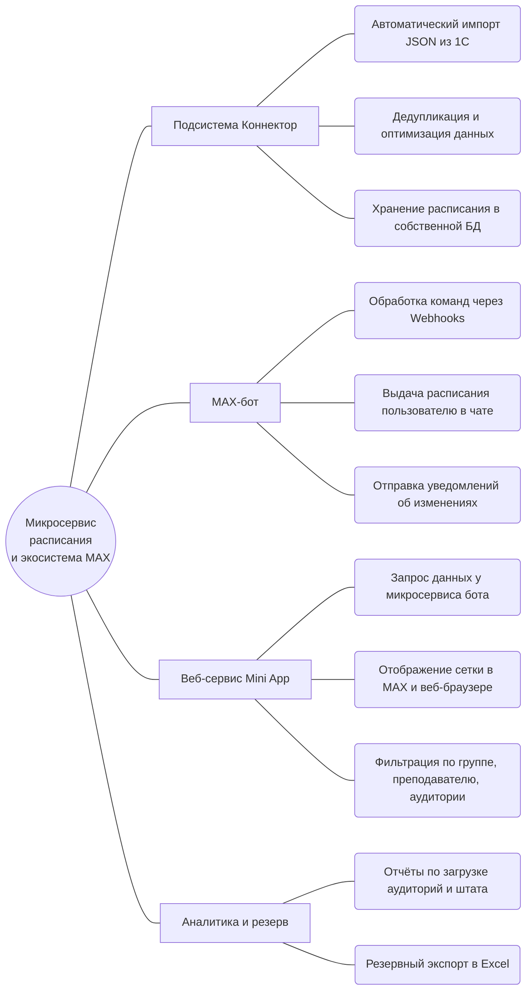
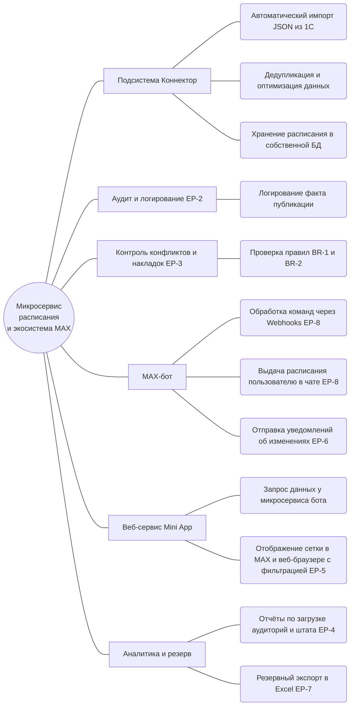

# Документ пользовательских требований

Вариант: 01-Расписание занятий в MAX
Команда: Крутые чуваки альфа-ураган динамитные волки
Связанный документ концепции: `case_concept.md` (лабораторная работа 1)  
Дата: 07.11.2026 12:11

Пользовательское требование фиксируется на уровне эпика. Каждый эпик оформлен и пользовательской историей, и сценарием использования.

## 1. Реинжиниринг дерева функций

| ID эпика | Пользовательское требование | Узел дерева функций | Есть в дереве | Что сделано |
| --- | --- | --- | --- | --- |
| EP-1 | Автоматически импортировать и оптимизировать расписание из 1С | Автоматический импорт JSON из 1С / Хранение расписания в собственной БД | да | оставлен |
| EP-2 | Вести журнал аудита системных действий и публикаций | Аудит и логирование / Логирование факта публикации | нет | добавлен новый узел |
| EP-3 | Контролировать накладки и коллизии аудиторного фонда (правило BR-2) | Контроль конфликтов и накладок / Дедупликация и оптимизация данных | нет | добавлен новый узел |
| EP-4 | Формировать аналитические отчёты по загрузке аудиторий и преподавателей | Отчёты по загрузке аудиторий и штата | да | оставлен |
| EP-5 | Отображать интерактивную сетку расписания в веб-сервисе Mini App | Отображение сетки в MAX и веб-браузере / Фильтрация по группе, преподавателю, аудитории | да | оставлен |
| EP-6 | Отправлять пуш-уведомления об оперативных изменениях через Chat Bot | MAX-бот / Отправка уведомлений об изменениях | да | оставлен |
| EP-7 | Выгружать расписание в регламентированный шаблон Excel | Резервный экспорт в Excel | да | оставлен |
| EP-8 | Просматривать расписание по запросу в чате MAX-бота | Выдача расписания пользователю в чате / Обработка команд через Webhooks | да | оставлен |

Скорректированное дерево:

## 2. Диаграмма вариантов использования

Исходник: `diagrams/usecase.puml`

Граница системы:

| Узел дерева | Вариант использования | Актор |
| --- | --- | --- |
| Автоматический импорт JSON из 1С | UC-1 Автоматический импорт и оптимизация из 1С | ИТ-система 1С, Сотрудник Учебного управления |
| Аудит и логирование | UC-2 Вести журнал аудита | Сотрудник Учебного управления, Администратор |
| Контроль конфликтов и накладок | UC-3 Контролировать коллизии аудиторного фонда | Сотрудник Учебного управления |
| Отчёты по загрузке аудиторий и штата | UC-4 Формировать аналитические отчёты | Сотрудник Учебного управления |
| Отображение сетки в MAX и веб-браузере | UC-5 Отображать сетку в Mini App | Студент / Преподаватель |
| Отправка уведомлений об изменениях | UC-6 Отправлять push-уведомления | Микросервис / MAX-бот |
| Резервный экспорт в Excel | UC-7 Резервный экспорт в Excel | Сотрудник Учебного управления |
| Выдача расписания пользователю в чате | UC-8 Просматривать расписание в чат-боте | Студент / Преподаватель |

## 4. Анализ сущностей

Исходник: `diagrams/logical-data.puml`.

| Сущность | Эпик или сценарий | Что хранит система | Ключ |
| --- | --- | --- | --- |
| Расписание и Сводка | EP-1, EP-5, EP-8 | Актуальные данные занятий, слоты времени, аудитории, преподавателей | id_занятия |
| Запись журнала аудита | EP-2 | Метаданные операций (импорт, экспорт, ошибки), инициатора и статус | id_записи |
| Конфликт / Коллизия | EP-3 | Зафиксированные пересечения аудиторий (BR-2) и преподавателей (BR-1) | id_конфликта |
| Пользовательская подписка | EP-6, EP-8 | Привязку пользователей MAX к учебным группам и преподавателям | id_подписки |
| Справочник 1С <<внешний>> | EP-1 | Исходные данные структуры вуза, читаемые по API | идентификатор объекта в 1С |

| Связь | Кратность | Откуда это видно в постусловии |
| --- | --- | --- |
| Справочник 1С ── Расписание | один ко многим (0..*) | Импорт из 1С наполняет локальную базу данных набором записей расписания (постусловие UC-1). |
| Расписание ── Конфликт | один к нулю-или-одному (0..1) | Валидация правил BR-1/BR-2 помечает занятие статусом конфликта (постусловие UC-3). |
| Расписание ── Подписка | один ко многим (0..*) | Изменения в расписании (дельта) сопоставляются со списком подписанных пользователей (постусловие UC-6). |
| Расписание ── Журнал аудита | один ко многим (0..*) | Ключевые действия с расписанием фиксируются в неизменяемом журнале (постусловие UC-2). |

## 5. Проверка

### 5.1. Подготовка

| Роль | Кто |
|------|-----|
| Аналитик | Игнатов М.Р. |
| Заказчик | представитель Учебного управления, в учебной сдаче это преподаватель |
| Разработчик | Тюрин С.С. |
| Тестировщик | Ежов Д.Д. |

Чек-лист - в разделе 6.  
Проверяются 8 эпиков (EP-1…EP-8), выделенных в разделе 3.

### 5.2. Полнота

| ID | Роль | Действие | Ценность | Контекст | Полнота | Что дополнить |
|----|------|----------|----------|----------|---------|---------------|
| EP-1 | сотрудник Учебного управления | загрузить и очистить расписание из 1С в базу микросервиса | не вбивать пары руками и иметь доступ при сбое 1С | расписание готово в 1С, запуск по таймеру | полное | |
| EP-2 | сотрудник Учебного управления | смотреть журнал действий системы | знать, кто и когда выгрузил расписание | система выполнила импорт, выгрузку или экспорт | полное | |
| EP-3 | сотрудник Учебного управления | проверить расписание на накладки (BR-2) | найти ошибки кафедр до публикации студентам | расписание загружено из 1С | полное | |
| EP-4 | сотрудник Учебного управления | получить отчеты по аудиториям и преподавателям | видеть перегруз и пустые аудитории | данные за семестр сохранены в базе | полное | |
| EP-5 | студент или преподаватель | смотреть сетку расписания в Mini App с фильтрами | видеть пары на неделю без поиска файлов на сайте | открыт Mini App в MAX или в браузере | полное | |
| EP-6 | студент или преподаватель | получать пуш-уведомления об отменах и переносах | вовремя узнать об изменениях | включен бот, в 1С изменились пары | полное | |
| EP-7 | сотрудник Учебного управления | выгрузить расписание в Excel по шаблону MAX | иметь запасной файл, если шлюз отключится | расписание есть в базе микросервиса | полное | |
| EP-8 | студент или преподаватель | запросить расписание на сегодня или завтра у бота | быстро узнать пары в чате | отправлена команда боту в MAX | полное | |

### 5.3. Однозначность и проверяемость

| Исходное требование | Проблема | Исправленное требование |
|---------------------|----------|-------------------------|
| «Мгновенно получать карточку с занятиями» в черновике US-3 / EP-8 | Слово «мгновенно» неизмеримо | Время ответа бота не больше 2 секунд (критерий SM-3 концепции) |
| «Наглядно просматривать сетку расписания» в черновике US-4 / EP-5 | Слово «наглядно» размыто | Сетка показывает дни недели и пары с 1 по 8 с фильтрами по группе, преподавателю и аудитории, загрузка до 2 секунд (SM-3) |
| «Обеспечить бесперебойную доступность расписания» в черновике EP-1 | Слово «бесперебойная» не задает метрику | При отказе сервера 1С база микросервиса отдает расписание без потери ранее сохраненных данных (NFR-A3) |
| «Своевременно корректировать планы» в черновике EP-6 | Слово «своевременно» неизмеримо | Пуш-уведомление приходит в течение 5 минут после обновления данных в 1С (Выпуск 2) |
| «Тяжелые и легкие справочники 1С» в черновике сценариев | Размытое деление | Заданы точные таймауты: 1800 секунд для подразделений и сотрудников (NFR-A1), 600 секунд для групп и планов (NFR-A2) |
| «Вовремя выявлять несогласованность данных» в EP-3 | Нет момента проверки | Проверка накладок запускается сразу при импорте до отправки в бот и Mini App |
| Не выявлено других размытых слов в EP-2, EP-4, EP-7 | Просмотрены эпики аудита, отчетов и Excel | Формулировки историй оставлены |

### 5.4. Непротиворечивость

| Требование A | Требование B | Конфликт | Решение |
|--------------|--------------|----------|---------|
| EP-1: расписание загружается из 1С | EP-3: при накладках фиксируется ошибка | Непонятно: если в 1С накладка, отменять ли весь импорт | Импорт не отменяется, иначе вуз останется без расписания. Спорные пары сохраняются, но помечаются как конфликт для отчета EP-4 |
| EP-1: расписание хранится в базе микросервиса | EP-5 и EP-8: пользователи смотрят расписание | Запросы из чата и Mini App могут перегрузить 1С | Пользователи читают данные только из базы микросервиса, прямых запросов к 1С от пользователей нет |
| EP-6: бот рассылает пуши при изменениях | Ограничения мессенджера MAX на спам | При массовом переносе пар отправка сотен сообщений разом приведет к бану бота | Сообщения отправляются пачками по 100-300 штук с паузой, а при сбое сохраняются в очередь (риск RI-3) |
| EP-5: расписание в Mini App | EP-8: расписание в чат-боте | Данные в боте и в Mini App могут не совпадать | Mini App не имеет отдельной базы, а берет данные у того же микросервиса бота. Данные всегда одинаковые |
| EP-7: выгрузка расписания в Excel | EP-2: журнал аудита | Диспетчер может выгрузить файл и изменить его без ведома системы | Каждая выгрузка в Excel записывается в журнал аудита с именем сотрудника и временем |

### 5.5. Атомарность

| Исходное требование | Проблема | Как разделено или почему оставлено одним эпиком |
|---------------------|----------|--------------------------------------------------|
| US-5 из концепции: отчеты по аудиториям, нагрузка преподавателей и поиск накладок в одном требовании | Содержит две разные цели | Разделено на EP-3 (автоматическая проверка накладок при импорте) и EP-4 (отчеты по загрузке для руководства) |
| US-3 и US-4: просмотр расписания в боте и в Mini App | Разные способы работы | Разделено на EP-8 (короткий ответ бота в чате на день) и EP-5 (полная сетка на неделю в Mini App с фильтрами) |
| EP-1: импорт JSON, очистка от дублей и запись в базу | Кажется, что шагов много | Это одна цель - получить чистое расписание из 1С в базу. Дробить на три эпика не стали, шаги описаны внутри сценария UC-1 |

### 5.6. Трассируемость

| ID | Требование | Источник | Бизнес-цель | Узел дерева | Вариант использования | Статус |
|----|------------|----------|-------------|-------------|----------------------|--------|
| EP-1 | Импорт и очистка расписания из 1С | Учебное управление, ИТ-отдел | BREQ-1 (сократить время сборки), BREQ-6 (0% ручного ввода), BO-1 | Автоматический импорт JSON из 1С | UC-1 | проверено |
| EP-2 | Журнал аудита действий и публикаций | Учебное управление | BREQ-5 (100% прозрачность действий), BO-1 | Аудит и логирование / Логирование факта публикации | UC-2 | проверено |
| EP-3 | Проверка накладок аудиторий (BR-2) | Учебное управление | BREQ-2 (прозрачная загрузка), BREQ-4 (без потери данных), BO-1, BO-3 | Контроль конфликтов и накладок | UC-3 | проверено |
| EP-4 | Отчеты по загрузке аудиторий и преподавателей | Учебное управление | BREQ-2 (2 отчета по загрузке), BO-3 | Отчёты по загрузке аудиторий и штата | UC-4 | проверено |
| EP-5 | Сетка расписания в Mini App | Студент, преподаватель | BREQ-3 (донести расписание в MAX ≥80%), BO-2 | Отображение сетки в MAX и веб-браузере | UC-5 | проверено |
| EP-6 | Пуш-уведомления об изменениях | Студент, преподаватель, Учебное управление | BREQ-3 (расписание в MAX), BO-2 | MAX-бот / Отправка уведомлений об изменениях | UC-6 | проверено |
| EP-7 | Резервный экспорт в Excel | Учебное управление | BREQ-4 (исключить потерю данных), BO-1 | Резервный экспорт в Excel | UC-7 | проверено |
| EP-8 | Запрос расписания в чате бота | Студент, преподаватель | BREQ-3 (расписание в MAX), BO-2 | Выдача расписания пользователю в чате | UC-8 | проверено |

### 5.7. Приоритет

| ID | Требование | Приоритет | Обоснование |
|----|------------|-----------|-------------|
| EP-1 | Импорт и очистка расписания из 1С | Must | Без него в системе нет данных: ручной ввод исключен из проекта (LI-1) |
| EP-2 | Журнал аудита | Must | Без него нельзя выполнить BREQ-5 (100% прозрачность) и понять, кто менял данные при сбое |
| EP-3 | Проверка накладок аудиторий | Must | Без проверки студенты придут на пары с накладками (две группы в одной аудитории) |
| EP-4 | Отчеты по загрузке | Should | Важно для контроля часов, но в первый день учебы студенты могут жить без отчетов |
| EP-5 | Сетка расписания в Mini App | Must | Основной экран просмотра на неделю; без него не выполнится охват студентов в MAX |
| EP-6 | Пуш-уведомления об изменениях | Should | Полезно для оперативных замен, но в первом релизе студенты могут посмотреть расписание в боте сами |
| EP-7 | Резервный экспорт в Excel | Could | Нужен только как запасной вариант на случай аварии мессенджера MAX |
| EP-8 | Запрос расписания в чате бота | Must | Главный способ быстро узнать пары на сегодня прямо в переписке |

### 5.8. Ревью

| Замечание | Кто | Решение | Что изменено |
|-----------|-----|---------|--------------|
| В вузе бывают потоковые лекции, когда 2-3 группы сидят в одной аудитории. Правило BR-2 не должно считать это ошибкой | заказчик | принято | В сценарий UC-3 добавлена проверка: если преподаватель и предмет совпадают, накладка не ставится |
| Убрать свою базу данных микросервиса и слать запросы сразу в 1С при каждом клике студента | разработчик | отклонено | 1С упадет от нагрузки в 8 утра, и нарушится требование NFR-A3 (доступность при сбое 1С). Своя база обязательна |
| Если мессенджер MAX временно недоступен, пуши об отмене пар не должны пропасть | тестировщик | принято | В UC-6 добавлена очередь повторной отправки: бот повторяет попытку, когда связь появится |
| Студенту лень каждый раз писать свою группу в чате бота | студент | принято | В UC-8 добавлено сохранение группы в профиле пользователя при первом входе |
| Сделать выгрузку в Excel обязательной в первую очередь | диспетчер | отклонено | Приоритет оставлен Could: главный канал - MAX (бот и Mini App), Excel нужен только как резерв |

### 5.9. Разбор с помощью ИИ

Инструмент: нейросетевая модель.

Промпт: «Проанализируй эпики EP-1…EP-8 расписания занятий в MAX на неполноту, противоречия и неоднозначность».

Ответ модели: перечень замечаний по определению дублей, потоковым лекциям, устареванию уведомлений и разделению интерфейсов.

| Замечание | Тип | Принято | Куда внесено |
|-----------|-----|---------|--------------|
| Не уточнен признак дубля при импорте из 1С | пробел | да | В сценарий UC-1: дубль - это совпадение группы, пары и аудитории от разных кафедр |
| Запрет двух групп в аудитории сломает потоковые пары | противоречие | да | В сценарий UC-3 добавлено исключение для потоковых лекций |
| Если связь пропала надолго, старые пуши об отмене вчерашних пар слать бессмысленно | пробел | да | В сценарий UC-6: если сообщению больше 12 часов, оно удаляется из очереди |
| Объединить просмотр в боте и Mini App в один общий эпик | дубль | нет | Цели разные: бот дает быстрый ответ в чате на день, Mini App дает всю сетку на неделю с фильтрами |

### 5.10. Протокол

| ID | Дефект | Тип | Рекомендация | Статус |
|----|--------|-----|--------------|--------|
| черновик US-1, US-2 | роль «Коннектор» вместо человека | неполнота | указать роль сотрудника Учебного управления | исправлено |
| черновик «мгновенно и наглядно» | нет точной меры времени | неоднозначность | задать время ответа ≤ 2 секунд по SM-3 | исправлено |
| черновик US-5 | отчеты и накладки в одной фразе | атомарность | разделить на EP-3 (накладки) и EP-4 (отчеты) | исправлено |
| черновик EP-1 | размытая «бесперебойность» | неоднозначность | указать доступность чтения при падении 1С | исправлено |
| сценарий UC-3 | потоковые лекции считались ошибкой | противоречие | добавить исключение для потока | исправлено |
| сценарий UC-6 | потеря пушей при сбое шлюза MAX | пробел | добавить очередь повторной отправки | исправлено |
| сценарий UC-8 | повторный ввод группы в чате | неполнота | сохранять выбранную группу в профиле | исправлено |
| дерево функций Lab 1 | не было узла журнала аудита | пробел в дереве | добавлен узел «Логирование факта публикации» | исправлено |

## 6. Чек-лист проверки пользовательского требования

Чек-лист заполнен по всем 12 критериям качества индивидуально для каждого из 8 эпиков системы «Расписание занятий в MAX».

| № | Критерий качества | EP-1 | EP-2 | EP-3 | EP-4 | EP-5 | EP-6 | EP-7 | EP-8 | Экспертный комментарий аналитика |
| :-: | :--- | :---: | :---: | :---: | :---: | :---: | :---: | :---: | :---: | :--- |
| **1** | **Указана роль пользователя** | Да | Да | Да | Да | Да | Да | Да | Да | Все роли привязаны к реальным стейкхолдерам: Учебное управление, Студент, Преподаватель. |
| **2** | **Указано действие** | Да | Да | Да | Да | Да | Да | Да | Да | Сформулировано конкретное действие в терминах предметной области без двусмысленностей. |
| **3** | **Указана ценность** | Да | Да | Да | Да | Да | Да | Да | Да | Отражена осязаемая практическая выгода для конкретной роли. |
| **4** | **Требование однозначно** | Да | Да | Да | Да | Да | Да | Да | Да | Исключены качественные наречия; терминология унифицирована с глоссарием концепции. |
| **5** | **Требование проверяемо** | Да | Да | Да | Да | Да | Да | Да | Да | Имеются измеримые критерии приемки (время отклика ≤ 2 с, таймауты 600/1800 с, 100% логирование). |
| **6** | **Требование атомарно** | Да | Да | Да | Да | Да | Да | Да | Да | Каждое требование описывает ровно одну самостоятельную пользовательскую цель. |
| **7** | **Не противоречит другим** | Да | Да | Да | Да | Да | Да | Да | Да | Архитектурно согласованы локальная БД (read-replica), изоляция 1С и батчинг пуш-уведомлений. |
| **8** | **Имеет уникальный ID** | Да | Да | Да | Да | Да | Да | Да | Да | Присвоены сквозные идентификаторы EP-1...EP-8, согласованные со сценариями UC-1...UC-8. |
| **9** | **Указан источник** | Да | Да | Да | Да | Да | Да | Да | Да | Указаны инициаторы: Учебное управление, ИТ-отдел, Студенты, Преподаватели. |
| **10** | **Указан приоритет** | Да | Да | Да | Да | Да | Да | Да | Да | Присвоены и обоснованы приоритеты MoSCoW (5 Must, 2 Should, 1 Could). |
| **11** | **Требование реализуемо** | Да | Да | Да | Да | Да | Да | Да | Да | Соответствует техническому ландшафту (Linux, Python/Node, PostgreSQL, MAX Bridge API). |
| **12** | **Требование актуально** | Да | Да | Да | Да | Да | Да | Да | Да | Полностью покрывает утвержденные границы Выпуска 1 и 2 документа концепции. |
